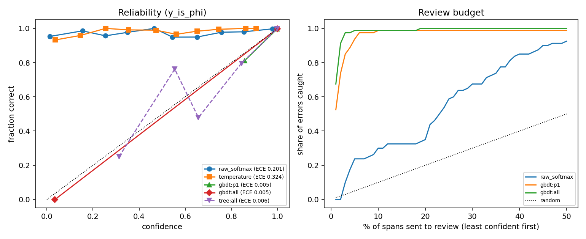

# Results on the MedDeID `cal` split (1000 notes)

## 1. Detector

| System | PHI recall (chars) [95% CI] | Non-PII redaction | Strict category P / R / F1 | False alarms | Hard negatives redacted |
|---|---|---|---|---|---|
| Baseline: repo rules + model (as shipped) | 91.4% [90.8%–92.0%] | 0.31% | 73.0% / 74.3% / 73.7% | 251 | 33 / 1000 |
| MedDeID rules only | 93.5% [92.8%–94.2%] | 0.06% | 97.0% / 90.9% / 93.9% | 16 | 2 / 1000 |
| Model only | 83.6% [82.7%–84.6%] | 0.04% | 72.8% / 69.1% / 70.9% | 57 | 14 / 1000 |
| **Improved: MedDeID rules + model** | 98.2% [97.9%–98.6%] | 0.09% | 93.3% / 94.3% / 93.8% | 72 | 15 / 1000 |

Per MedDeID label (improved detector):

| Label | n | Found (any overlap) | Category correct | Exact |
|---|---|---|---|---|
| Name:Patient | 1110 | 99.7% | 99.6% | 98.6% |
| Name:Caregiver | 646 | 98.1% | 95.2% | 89.5% |
| Name:Other | 448 | 96.2% | 93.1% | 87.5% |
| Address_Location:Patient | 363 | 100.0% | 100.0% | 95.9% |
| Address_Location:Caregiver | 50 | 94.0% | 80.0% | 80.0% |
| Address_Location:Other | 79 | 93.7% | 88.6% | 83.5% |
| Organization:Healthcare | 435 | 99.1% | 96.8% | 80.9% |
| Organization:Other | 98 | 99.0% | 92.9% | 85.7% |
| ID:Patient | 921 | 99.8% | 99.8% | 98.2% |
| ID:Caregiver | 167 | 89.8% | 88.0% | 88.0% |
| Date | 523 | 100.0% | 100.0% | 100.0% |
| Age_Birthdate | 470 | 99.8% | 99.6% | 98.5% |
| Contactdetails | 317 | 100.0% | 98.7% | 98.7% |
| Profession | 123 | 97.6% | 97.6% | 97.6% |
| **all** | 5750 | 98.8% | 97.6% | 94.3% |

By locale: en-GB recall 98.4%, en-US recall 98.0%. By document type: clinic_note 98.6%, discharge_summary 98.9%, emergency_note 97.2%, laboratory_report 99.6%, nursing_note 98.0%, referral_letter 97.2%.

## 2. Confidence of predicted spans (out-of-fold by note)

### Is the span PHI at all? (`y_is_phi`): 5813 spans, 80 errors

| Model | ECE ↓ | Brier ↓ | AUROC(error) ↑ | errors caught @5% / 10% / 20% review | precision before → after (≤0.1% recall loss) |
|---|---|---|---|---|---|
| raw_softmax | 0.2006 [0.194–0.208] | 0.1318 | 0.765 | 24% / 30% / 35% | 98.62% → 98.62% |
| raw_score | 0.0111 | 0.0136 | 0.822 | 64% / 70% / 72% | 98.62% → 98.67% |
| temperature | 0.3242 [0.319–0.330] | 0.1563 | 0.764 | 24% / 29% / 35% | 98.62% → 98.62% |
| platt | 0.0018 | 0.0135 | 0.750 | 24% / 29% / 41% | 98.62% → 98.62% |
| calibrated_mean | 0.0066 | 0.0131 | 0.789 | 29% / 40% / 56% | 98.62% → 98.66% |
| gbdt:p1 | 0.0049 [0.004–0.008] | 0.0072 | 0.985 | 94% / 99% / 99% | 98.62% → 99.15% |
| gbdt:p1+p2 | 0.0060 | 0.0060 | 0.989 | 95% / 99% / 99% | 98.62% → 99.31% |
| gbdt:our | 0.0048 | 0.0062 | 0.993 | 96% / 99% / 100% | 98.62% → 99.27% |
| gbdt:p1+p2+our | 0.0045 | 0.0046 | 0.996 | 99% / 99% / 100% | 98.62% → 99.57% |
| gbdt:all | 0.0045 [0.003–0.007] | 0.0046 | 0.996 | 99% / 99% / 100% | 98.62% → 99.57% |
| tree:p1 | 0.0073 | 0.0123 | 0.909 | 62% / 76% / 88% | 98.62% → 98.64% |
| tree:all | 0.0062 [0.005–0.009] | 0.0094 | 0.942 | 90% / 92% / 92% | 98.62% → 98.66% |

Shift test, forecaster trained on lang=en-GB (2891 spans) and scored on lang=en-US (2922 spans): gbdt:p1 ECE 0.0060, AUROC 0.977; gbdt:all ECE 0.0056, AUROC 0.973; raw_softmax ECE 0.1935, AUROC 0.767.

### …and is the category right? (`y_cat_ok`): 5813 spans, 198 errors

| Model | ECE ↓ | Brier ↓ | AUROC(error) ↑ | errors caught @5% / 10% / 20% review | precision before → after (≤0.1% recall loss) |
|---|---|---|---|---|---|
| raw_softmax | 0.1848 | 0.1448 | 0.650 | 11% / 14% / 18% | 96.59% → 96.59% |
| raw_score | 0.0221 | 0.0266 | 0.904 | 63% / 85% / 86% | 96.59% → 96.64% |
| temperature | 0.3115 | 0.1645 | 0.649 | 11% / 13% / 19% | 96.59% → 96.59% |
| platt | 0.0047 | 0.0328 | 0.645 | 11% / 13% / 23% | 96.59% → 96.59% |
| calibrated_mean | 0.0054 | 0.0320 | 0.738 | 19% / 31% / 51% | 96.59% → 96.62% |
| gbdt:p1 | 0.0077 | 0.0238 | 0.931 | 58% / 73% / 90% | 96.59% → 96.97% |
| gbdt:p1+p2 | 0.0114 | 0.0190 | 0.958 | 73% / 86% / 93% | 96.59% → 97.33% |
| gbdt:our | 0.0039 | 0.0095 | 0.989 | 91% / 97% / 98% | 96.59% → 98.72% |
| gbdt:p1+p2+our | 0.0063 | 0.0088 | 0.989 | 93% / 98% / 98% | 96.59% → 98.72% |
| gbdt:all | 0.0063 | 0.0088 | 0.989 | 93% / 98% / 98% | 96.59% → 98.72% |
| tree:p1 | 0.0051 | 0.0302 | 0.848 | 24% / 39% / 73% | 96.59% → 96.64% |
| tree:all | 0.0068 | 0.0143 | 0.920 | 84% / 88% / 88% | 96.59% → 98.08% |

Shift test, forecaster trained on lang=en-US (2922 spans) and scored on lang=en-GB (2891 spans): gbdt:p1 ECE 0.0111, AUROC 0.919; gbdt:all ECE 0.0075, AUROC 0.979; raw_softmax ECE 0.1916, AUROC 0.657.

### …and are the boundaries exact? (`y_exact`): 5813 spans, 389 errors

| Model | ECE ↓ | Brier ↓ | AUROC(error) ↑ | errors caught @5% / 10% / 20% review | precision before → after (≤0.1% recall loss) |
|---|---|---|---|---|---|
| raw_softmax | 0.1574 | 0.1516 | 0.702 | 6% / 15% / 29% | 93.31% → 93.30% |
| raw_score | 0.0527 | 0.0536 | 0.790 | 47% / 62% / 66% | 93.31% → 93.35% |
| temperature | 0.2819 | 0.1679 | 0.701 | 6% / 15% / 29% | 93.31% → 93.30% |
| platt | 0.0309 | 0.0623 | 0.698 | 6% / 16% / 29% | 93.31% → 93.30% |
| calibrated_mean | 0.0093 | 0.0579 | 0.761 | 17% / 31% / 52% | 93.31% → 93.54% |
| gbdt:p1 | 0.0082 | 0.0312 | 0.936 | 59% / 76% / 87% | 93.31% → 94.79% |
| gbdt:p1+p2 | 0.0096 | 0.0190 | 0.976 | 69% / 91% / 95% | 93.31% → 96.79% |
| gbdt:our | 0.0070 | 0.0177 | 0.984 | 70% / 92% / 98% | 93.31% → 97.46% |
| gbdt:p1+p2+our | 0.0050 | 0.0098 | 0.991 | 73% / 97% / 99% | 93.31% → 97.62% |
| gbdt:all | 0.0050 | 0.0098 | 0.991 | 73% / 97% / 99% | 93.31% → 97.62% |
| tree:p1 | 0.0074 | 0.0478 | 0.804 | 34% / 42% / 55% | 93.31% → 94.72% |
| tree:all | 0.0082 | 0.0232 | 0.928 | 66% / 84% / 89% | 93.31% → 96.15% |

Most useful features (permutation importance, `gbdt:all`, is-PHI): `p1_p_o_mean`, `our_score`, `p1_p_cat_geo`, `our_rule`, `p1_len_words`, `p2_prev_p_same`, `p2_pdm_o_b9`, `p2_frac_words_entity`.

## 3. Missed PHI: near-miss candidates and note-level leak risk (our addition)

- 855 candidates (τ = 0.02); 111 contain missed PHI.
- Gold spans left (partly) uncovered by the detector: 194; 110 of them have a candidate (57% coverage).

| Forecaster | AUROC | AUPRC | missed found in top 5% / 10% / 20% of candidates | add p ≥ 0.5: added / truly missed / precision |
|---|---|---|---|---|
| raw_mass | 0.882 | 0.491 | 23% / 50% / 70% | 140 / 72 / 51% |
| p1 | 0.900 | 0.730 | 38% / 55% / 75% | 70 / 58 / 83% |
| p1+p2 | 0.956 | 0.864 | 38% / 67% / 90% | 87 / 75 / 86% |
| all | 0.981 | 0.943 | 39% / 74% / 95% | 99 / 94 / 95% |

Note level: 166 of 1000 notes contain a missed span. P(≥1 miss) = 1 − Π(1 − pᵢ): AUROC **0.835** (baseline, candidate count: 0.705), ECE 0.077. Reviewing the riskiest 5 / 10 / 20% of notes finds 33% / 58% / 69% of all missed spans.

## 4. Hard negatives and cost

- Hard negatives (look like PHI, are not): 15 of 1000 redacted by the detector; the confidence layer flags 13 of those 15 for review.
- Cost per note on CPU: rules 9 ms, model 0.40 s.
