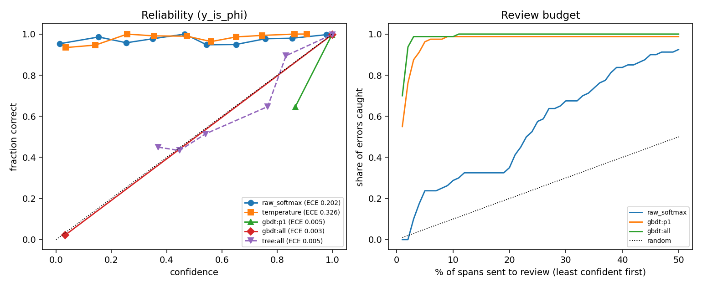

# Results on the MedDeID `cal` split (1000 notes)

## 1. Detector

| System | PHI recall (chars) [95% CI] | Non-PII redaction | Strict category P / R / F1 | False alarms | Hard negatives redacted |
|---|---|---|---|---|---|
| Baseline: regex + NER model | 91.4% [90.8%–92.0%] | 0.31% | 73.0% / 74.3% / 73.7% | 251 | 33 / 1000 |
| MedDeID rules only | 94.1% [93.5%–94.8%] | 0.06% | 97.6% / 91.6% / 94.5% | 16 | 2 / 1000 |
| Model only | 83.6% [82.7%–84.6%] | 0.04% | 72.8% / 69.1% / 70.9% | 57 | 14 / 1000 |
| **Improved: MedDeID rules + model** | 98.5% [98.2%–98.8%] | 0.09% | 94.1% / 94.9% / 94.5% | 72 | 15 / 1000 |

Per MedDeID label (improved detector):

| Label | n | Found (any overlap) | Category correct | Exact |
|---|---|---|---|---|
| Name:Patient | 1110 | 99.7% | 99.6% | 98.6% |
| Name:Caregiver | 646 | 98.1% | 95.2% | 89.5% |
| Name:Other | 448 | 96.2% | 93.1% | 87.5% |
| Address_Location:Patient | 363 | 100.0% | 100.0% | 95.9% |
| Address_Location:Caregiver | 50 | 94.0% | 80.0% | 80.0% |
| Address_Location:Other | 79 | 93.7% | 88.6% | 83.5% |
| Organization:Healthcare | 435 | 99.5% | 98.2% | 85.1% |
| Organization:Other | 98 | 99.0% | 92.9% | 85.7% |
| ID:Patient | 921 | 99.9% | 99.9% | 99.8% |
| ID:Caregiver | 167 | 89.8% | 88.0% | 88.0% |
| Date | 523 | 100.0% | 100.0% | 100.0% |
| Age_Birthdate | 470 | 99.8% | 99.6% | 98.5% |
| Contactdetails | 317 | 100.0% | 98.7% | 98.7% |
| Profession | 123 | 97.6% | 97.6% | 97.6% |
| **all** | 5750 | 98.9% | 97.7% | 94.9% |

By locale: en-GB recall 98.8%, en-US recall 98.2%. By document type: clinic_note 98.9%, discharge_summary 99.0%, emergency_note 98.1%, laboratory_report 99.8%, nursing_note 98.2%, referral_letter 97.3%.

## 2. Confidence of predicted spans (out-of-fold by note)

### Is the span PHI at all? (`y_is_phi`): 5800 spans, 80 errors

| Model | ECE ↓ | Brier ↓ | AUROC(error) ↑ | errors caught @5% / 10% / 20% review | precision before → after (≤0.1% recall loss) |
|---|---|---|---|---|---|
| raw_softmax | 0.2022 [0.195–0.210] | 0.1333 | 0.764 | 24% / 29% / 35% | 98.62% → 98.62% |
| raw_score | 0.0104 | 0.0133 | 0.824 | 64% / 70% / 72% | 98.62% → 98.67% |
| temperature | 0.3258 [0.320–0.331] | 0.1573 | 0.762 | 24% / 29% / 35% | 98.62% → 98.62% |
| platt | 0.0019 | 0.0135 | 0.749 | 24% / 28% / 45% | 98.62% → 98.62% |
| calibrated_mean | 0.0048 | 0.0131 | 0.799 | 31% / 39% / 59% | 98.62% → 98.67% |
| gbdt:p1 | 0.0051 [0.004–0.008] | 0.0072 | 0.985 | 96% / 99% / 99% | 98.62% → 99.03% |
| gbdt:p1+mc | 0.0041 | 0.0058 | 0.989 | 95% / 98% / 99% | 98.62% → 99.30% |
| gbdt:p1+p2 | 0.0052 | 0.0060 | 0.988 | 94% / 99% / 99% | 98.62% → 99.25% |
| gbdt:our | 0.0032 | 0.0057 | 0.995 | 99% / 100% / 100% | 98.62% → 99.34% |
| gbdt:p1+p2+our | 0.0043 | 0.0045 | 0.996 | 99% / 99% / 100% | 98.62% → 99.56% |
| gbdt:all | 0.0033 [0.002–0.005] | 0.0035 | 0.998 | 99% / 99% / 100% | 98.62% → 99.67% |
| tree:p1 | 0.0042 | 0.0120 | 0.919 | 66% / 80% / 90% | 98.62% → 98.65% |
| tree:all | 0.0049 [0.004–0.008] | 0.0090 | 0.947 | 90% / 91% / 91% | 98.62% → 98.65% |

Shift test, forecaster trained on lang=en-GB (2889 spans) and scored on lang=en-US (2911 spans): gbdt:p1 ECE 0.0058, AUROC 0.974; gbdt:all ECE 0.0047, AUROC 0.987; raw_softmax ECE 0.1952, AUROC 0.765.

### …and is the category right? (`y_cat_ok`): 5800 spans, 182 errors

| Model | ECE ↓ | Brier ↓ | AUROC(error) ↑ | errors caught @5% / 10% / 20% review | precision before → after (≤0.1% recall loss) |
|---|---|---|---|---|---|
| raw_softmax | 0.1854 | 0.1442 | 0.669 | 12% / 14% / 19% | 96.86% → 96.86% |
| raw_score | 0.0197 | 0.0242 | 0.902 | 69% / 85% / 86% | 96.86% → 96.91% |
| temperature | 0.3142 | 0.1638 | 0.668 | 12% / 14% / 18% | 96.86% → 96.86% |
| platt | 0.0041 | 0.0303 | 0.653 | 10% / 13% / 20% | 96.86% → 96.86% |
| calibrated_mean | 0.0073 | 0.0296 | 0.760 | 16% / 30% / 50% | 96.86% → 96.91% |
| gbdt:p1 | 0.0072 | 0.0215 | 0.937 | 62% / 80% / 88% | 96.86% → 97.23% |
| gbdt:p1+mc | 0.0075 | 0.0200 | 0.947 | 65% / 81% / 91% | 96.86% → 97.31% |
| gbdt:p1+p2 | 0.0090 | 0.0151 | 0.955 | 76% / 85% / 91% | 96.86% → 98.01% |
| gbdt:our | 0.0054 | 0.0093 | 0.988 | 90% / 97% / 98% | 96.86% → 98.91% |
| gbdt:p1+p2+our | 0.0062 | 0.0077 | 0.989 | 94% / 98% / 99% | 96.86% → 99.10% |
| gbdt:all | 0.0064 | 0.0079 | 0.989 | 95% / 98% / 99% | 96.86% → 99.03% |
| tree:p1 | 0.0081 | 0.0280 | 0.850 | 29% / 42% / 70% | 96.86% → 96.93% |
| tree:all | 0.0053 | 0.0115 | 0.950 | 86% / 92% / 92% | 96.86% → 98.39% |

Shift test, forecaster trained on lang=en-GB (2889 spans) and scored on lang=en-US (2911 spans): gbdt:p1 ECE 0.0117, AUROC 0.918; gbdt:all ECE 0.0109, AUROC 0.984; raw_softmax ECE 0.1778, AUROC 0.673.

### …and are the boundaries exact? (`y_exact`): 5800 spans, 343 errors

| Model | ECE ↓ | Brier ↓ | AUROC(error) ↑ | errors caught @5% / 10% / 20% review | precision before → after (≤0.1% recall loss) |
|---|---|---|---|---|---|
| raw_softmax | 0.1628 | 0.1485 | 0.713 | 7% / 15% / 30% | 94.09% → 94.08% |
| raw_score | 0.0457 | 0.0469 | 0.802 | 52% / 64% / 68% | 94.09% → 94.13% |
| temperature | 0.2886 | 0.1661 | 0.712 | 6% / 16% / 30% | 94.09% → 94.08% |
| platt | 0.0321 | 0.0555 | 0.701 | 6% / 16% / 34% | 94.09% → 94.08% |
| calibrated_mean | 0.0097 | 0.0516 | 0.764 | 20% / 34% / 50% | 94.09% → 94.21% |
| gbdt:p1 | 0.0064 | 0.0268 | 0.947 | 64% / 79% / 89% | 94.09% → 95.38% |
| gbdt:p1+mc | 0.0087 | 0.0269 | 0.946 | 62% / 79% / 89% | 94.09% → 95.41% |
| gbdt:p1+p2 | 0.0082 | 0.0169 | 0.975 | 75% / 91% / 95% | 94.09% → 97.25% |
| gbdt:our | 0.0063 | 0.0149 | 0.981 | 76% / 92% / 97% | 94.09% → 97.78% |
| gbdt:p1+p2+our | 0.0051 | 0.0090 | 0.991 | 81% / 98% / 99% | 94.09% → 98.32% |
| gbdt:all | 0.0064 | 0.0091 | 0.991 | 81% / 97% / 99% | 94.09% → 98.27% |
| tree:p1 | 0.0072 | 0.0434 | 0.801 | 37% / 46% / 53% | 94.09% → 95.02% |
| tree:all | 0.0057 | 0.0201 | 0.946 | 71% / 85% / 92% | 94.09% → 96.79% |

Shift test, forecaster trained on lang=en-GB (2889 spans) and scored on lang=en-US (2911 spans): gbdt:p1 ECE 0.0154, AUROC 0.927; gbdt:all ECE 0.0137, AUROC 0.990; raw_softmax ECE 0.1541, AUROC 0.719.

Most useful features (permutation importance, `gbdt:all`, is-PHI): `p1_mc_o_mean`, `our_score`, `p1_p_cat_geo`, `our_rule`, `p2_prev_p_same`, `our_frac_alpha`, `p1_len_words`, `our_rel_pos`.

## 3. Missed PHI: near-miss candidates and note-level leak risk (our addition)

- 838 candidates (τ = 0.02); 94 contain missed PHI.
- Gold spans left (partly) uncovered by the detector: 110; 93 of them have a candidate (85% coverage).

| Forecaster | AUROC | AUPRC | missed found in top 5% / 10% / 20% of candidates | add p ≥ 0.5: added / truly missed / precision |
|---|---|---|---|---|
| raw_mass | 0.889 | 0.464 | 27% / 53% / 73% | 131 / 63 / 48% |
| p1 | 0.915 | 0.735 | 43% / 62% / 80% | 69 / 54 / 78% |
| p1+p2 | 0.939 | 0.835 | 43% / 71% / 89% | 76 / 62 / 82% |
| all | 0.977 | 0.912 | 44% / 79% / 97% | 86 / 75 / 87% |

Note level: 98 of 1000 notes contain a missed span. P(≥1 miss) = 1 − Π(1 − pᵢ): AUROC **0.947** (baseline, candidate count: 0.771), ECE 0.025. Reviewing the riskiest 5 / 10 / 20% of notes finds 52% / 81% / 89% of all missed spans.

## 4. Hard negatives and cost

- Hard negatives (look like PHI, are not): 15 of 1000 redacted by the detector; the confidence layer flags 13 of those 15 for review.
- Cost per note on CPU: rules 9 ms, model 0.40 s, MC dropout (10 passes) 4.5 s.
