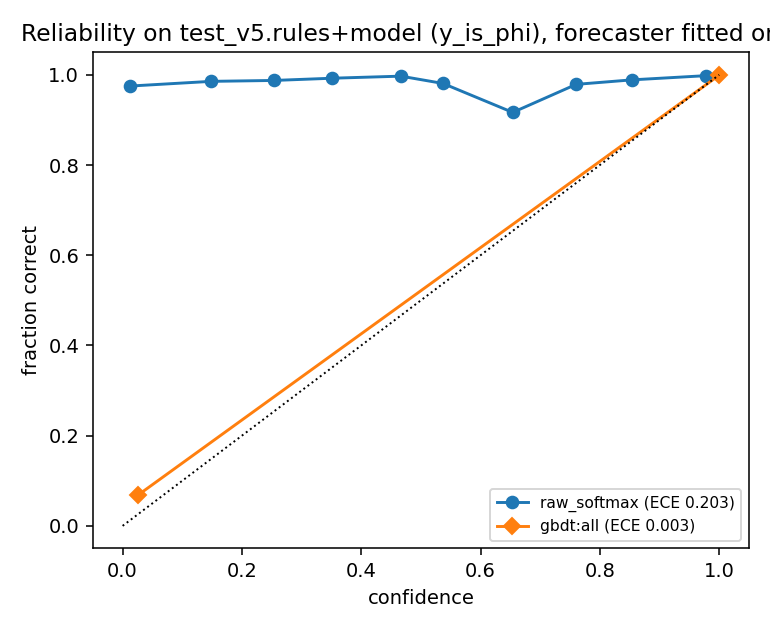

# Results on the MedDeID `test` split (1008 notes)

## 1. Detector

| System | PHI recall (chars) [95% CI] | Non-PII redaction | Strict category P / R / F1 | False alarms | Hard negatives redacted |
|---|---|---|---|---|---|
| Baseline: regex + NER model | 91.1% [90.5%–91.7%] | 0.30% | 73.3% / 74.2% / 73.8% | 244 | 32 / 1008 |
| MedDeID rules only | 94.1% [93.5%–94.8%] | 0.04% | 97.6% / 91.6% / 94.5% | 9 | 0 / 1008 |
| Model only | 83.4% [82.5%–84.3%] | 0.03% | 73.2% / 69.0% / 71.0% | 51 | 11 / 1008 |
| **Improved: MedDeID rules + model** | 98.5% [98.3%–98.9%] | 0.07% | 94.1% / 94.9% / 94.5% | 60 | 11 / 1008 |

Per MedDeID label (improved detector):

| Label | n | Found (any overlap) | Category correct | Exact |
|---|---|---|---|---|
| Name:Patient | 1125 | 99.8% | 99.6% | 99.0% |
| Name:Caregiver | 636 | 97.2% | 94.0% | 87.7% |
| Name:Other | 442 | 95.9% | 92.5% | 87.1% |
| Address_Location:Patient | 373 | 100.0% | 100.0% | 95.2% |
| Address_Location:Caregiver | 47 | 97.9% | 87.2% | 87.2% |
| Address_Location:Other | 60 | 90.0% | 83.3% | 76.7% |
| Organization:Healthcare | 452 | 99.6% | 99.1% | 88.3% |
| Organization:Other | 105 | 98.1% | 92.4% | 85.7% |
| ID:Patient | 919 | 100.0% | 99.9% | 99.8% |
| ID:Caregiver | 187 | 94.1% | 90.4% | 90.4% |
| Date | 518 | 100.0% | 100.0% | 100.0% |
| Age_Birthdate | 444 | 99.1% | 99.1% | 96.8% |
| Contactdetails | 347 | 100.0% | 98.6% | 98.6% |
| Profession | 135 | 97.8% | 97.8% | 97.8% |
| **all** | 5790 | 98.8% | 97.7% | 94.9% |

By locale: en-GB recall 98.8%, en-US recall 98.3%. By document type: clinic_note 98.7%, discharge_summary 98.7%, emergency_note 98.3%, laboratory_report 99.6%, nursing_note 98.6%, referral_letter 97.7%.

## 2. Confidence of predicted spans (out-of-fold by note)

### Is the span PHI at all? (`y_is_phi`): 5838 spans, 62 errors

| Model | ECE ↓ | Brier ↓ | AUROC(error) ↑ | errors caught @5% / 10% / 20% review | precision before → after (≤0.1% recall loss) |
|---|---|---|---|---|---|
| raw_softmax | 0.2033 [0.195–0.212] | 0.1324 | 0.752 | 16% / 19% / 26% | 98.94% → 98.94% |
| raw_score | 0.0082 [0.007–0.011] | 0.0103 | 0.889 | 76% / 84% / 85% | 98.94% → 98.99% |
| gbdt:all | 0.0028 [0.002–0.005] | 0.0029 | 0.998 | 100% / 100% / 100% | 98.94% → 99.72% |

### …and is the category right? (`y_cat_ok`): 5838 spans, 179 errors

| Model | ECE ↓ | Brier ↓ | AUROC(error) ↑ | errors caught @5% / 10% / 20% review | precision before → after (≤0.1% recall loss) |
|---|---|---|---|---|---|
| raw_softmax | 0.1833 [0.175–0.192] | 0.1432 | 0.673 | 9% / 10% / 16% | 96.93% → 96.93% |
| raw_score | 0.0178 [0.015–0.022] | 0.0222 | 0.935 | 75% / 91% / 92% | 96.93% → 97.01% |
| gbdt:all | 0.0045 [0.003–0.007] | 0.0060 | 0.997 | 98% / 99% / 100% | 96.93% → 99.07% |

### …and are the boundaries exact? (`y_exact`): 5838 spans, 342 errors

| Model | ECE ↓ | Brier ↓ | AUROC(error) ↑ | errors caught @5% / 10% / 20% review | precision before → after (≤0.1% recall loss) |
|---|---|---|---|---|---|
| raw_softmax | 0.1596 [0.151–0.170] | 0.1478 | 0.714 | 6% / 14% / 29% | 94.14% → 94.14% |
| raw_score | 0.0447 [0.038–0.051] | 0.0459 | 0.807 | 54% / 65% / 68% | 94.14% → 94.27% |
| gbdt:all | 0.0053 [0.004–0.009] | 0.0074 | 0.997 | 84% / 98% / 100% | 94.14% → 98.97% |

## 3. Missed PHI: near-miss candidates and note-level leak risk (our addition)

- 877 candidates (τ = 0.02); 99 contain missed PHI.
- Gold spans left (partly) uncovered by the detector: 114; 98 of them have a candidate (86% coverage).

| Forecaster | AUROC | AUPRC | missed found in top 5% / 10% / 20% of candidates | add p ≥ 0.5: added / truly missed / precision |
|---|---|---|---|---|
| raw_mass | 0.858 | 0.375 | 22% / 40% / 71% | 129 / 53 / 41% |
| all | 0.990 | 0.945 | 44% / 83% / 99% | 80 / 76 / 95% |

Note level: 98 of 1008 notes contain a missed span. P(≥1 miss) = 1 − Π(1 − pᵢ): AUROC **0.964** (baseline, candidate count: 0.770), ECE 0.026. Reviewing the riskiest 5 / 10 / 20% of notes finds 53% / 84% / 93% of all missed spans.

## 4. Hard negatives and cost

- Hard negatives (look like PHI, are not): 11 of 1008 redacted by the detector; the confidence layer flags 9 of those 11 for review.
- Cost per note on CPU: rules 17 ms, model 0.35 s, MC dropout (10 passes) 4.3 s.
