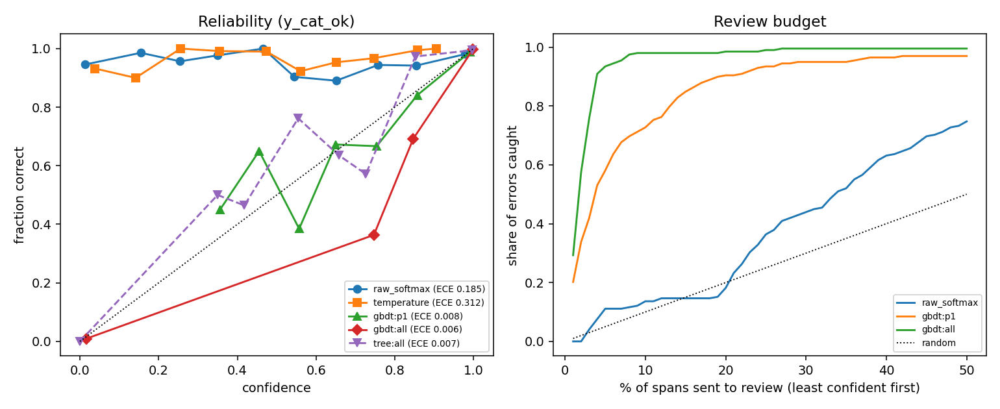

# Confidence models: `cal_v4.rules+model.csv`, target `y_cat_ok`

5813 predicted spans, 198 errors (3.41%). 5-fold GroupKFold by note. MC dropout features: no.

| Model | ECE ↓ | Brier ↓ | NLL ↓ | AUROC(error) ↑ | errors caught @5% | @10% | @20% | precision before → after (≤0.1% recall loss) |
|---|---|---|---|---|---|---|---|---|
| raw_softmax | 0.1848 | 0.1448 | 0.832 | 0.650 | 11% | 14% | 18% | 96.59% → 96.59% (−0 errors, −5 PHI) |
| raw_score | 0.0221 | 0.0266 | 0.138 | 0.904 | 63% | 85% | 86% | 96.59% → 96.64% (−3 errors, −5 PHI) |
| temperature | 0.3115 | 0.1645 | 0.550 | 0.649 | 11% | 13% | 19% | 96.59% → 96.59% (−0 errors, −5 PHI) |
| platt | 0.0047 | 0.0328 | 0.146 | 0.645 | 11% | 13% | 23% | 96.59% → 96.59% (−0 errors, −5 PHI) |
| calibrated_mean | 0.0054 | 0.0320 | 0.137 | 0.738 | 19% | 31% | 51% | 96.59% → 96.62% (−2 errors, −5 PHI) |
| gbdt:p1 | 0.0077 | 0.0238 | 0.089 | 0.931 | 58% | 73% | 90% | 96.59% → 96.97% (−23 errors, −5 PHI) |
| gbdt:p1+p2 | 0.0114 | 0.0190 | 0.073 | 0.958 | 73% | 86% | 93% | 96.59% → 97.33% (−44 errors, −5 PHI) |
| gbdt:p1+p2+our | 0.0063 | 0.0088 | 0.033 | 0.989 | 93% | 98% | 98% | 96.59% → 98.72% (−125 errors, −5 PHI) |
| gbdt:our | 0.0039 | 0.0095 | 0.035 | 0.989 | 91% | 97% | 98% | 96.59% → 98.72% (−125 errors, −5 PHI) |
| gbdt:all | 0.0063 | 0.0088 | 0.033 | 0.989 | 93% | 98% | 98% | 96.59% → 98.72% (−125 errors, −5 PHI) |
| tree:p1 | 0.0051 | 0.0302 | 0.123 | 0.848 | 24% | 39% | 73% | 96.59% → 96.64% (−3 errors, −5 PHI) |
| tree:all | 0.0068 | 0.0143 | 0.065 | 0.920 | 84% | 88% | 88% | 96.59% → 98.08% (−88 errors, −5 PHI) |

## ECE by group (gbdt:all vs raw softmax)

| Group | n | errors | ECE gbdt:all | ECE raw |
|---|---|---|---|---|
| category=Address_Location | 504 | 30 | 0.0267 | 0.2071 |
| category=Age_Birthdate | 478 | 10 | 0.0069 | 0.5253 |
| category=Contactdetails | 317 | 4 | 0.0067 | 0.0185 |
| category=Date | 526 | 3 | 0.0026 | 0.0029 |
| category=Name | 2175 | 39 | 0.0074 | 0.1412 |
| category=Organization | 537 | 26 | 0.0253 | 0.3631 |
| our_rule_family=format | 1204 | 11 | 0.0065 | 0.1529 |
| our_rule_family=header | 3402 | 13 | 0.0020 | 0.2593 |
| our_rule_family=narrative | 447 | 7 | 0.0025 | 0.1435 |
| our_rule_family=other | 760 | 167 | 0.0336 | 0.1261 |
| lang=en-GB | 2891 | 96 | 0.0064 | 0.1916 |
| lang=en-US | 2922 | 102 | 0.0078 | 0.1781 |
| doc_type=clinic_note | 987 | 25 | 0.0065 | 0.2524 |
| doc_type=discharge_summary | 1007 | 32 | 0.0176 | 0.1620 |
| doc_type=emergency_note | 933 | 32 | 0.0084 | 0.1824 |
| doc_type=laboratory_report | 956 | 22 | 0.0056 | 0.1442 |
| doc_type=nursing_note | 917 | 37 | 0.0074 | 0.1680 |
| doc_type=referral_letter | 1013 | 50 | 0.0088 | 0.2027 |

## Most important features (permutation, gbdt:all)

- `our_score`: 0.0536
- `our_category`: 0.0430
- `p1_p_cat_geo`: 0.0112
- `p1_p_o_mean`: 0.0083
- `p1_len_words`: 0.0030
- `p1_p_o_max`: 0.0021
- `p2_prev_p_same`: 0.0019
- `our_rule`: 0.0018
- `p1_len_chars`: 0.0017
- `our_src_both`: 0.0016
- `our_frac_alpha`: 0.0015
- `p2_pdm_o_b0`: 0.0014
- `our_case`: 0.0013
- `p2_nb_entropy_mean`: 0.0012
- `p2_next_p_same`: 0.0011
- `p2_note_entity_frac`: 0.0010
- `our_rel_pos`: 0.0010
- `p2_top_gap_mean`: 0.0010
- `p2_nb_p_same_mean`: 0.0009
- `p2_top_ratio_mean`: 0.0009

Decision tree (paper 2 style explanations): `tree.txt`.
