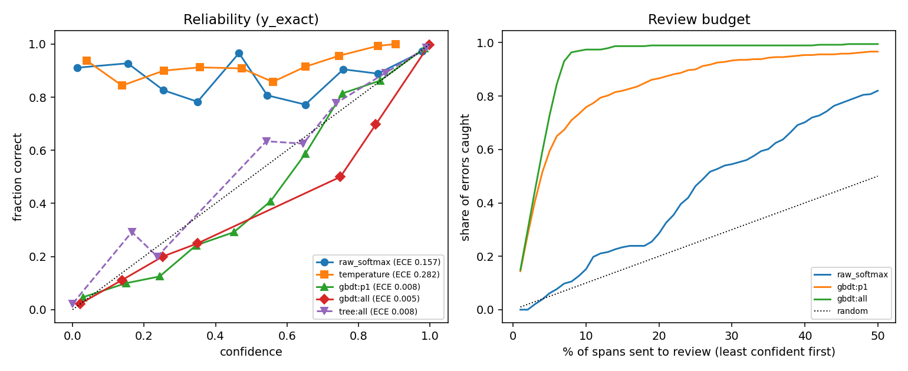

# Confidence models: `cal_v4.rules+model.csv`, target `y_exact`

5813 predicted spans, 389 errors (6.69%). 5-fold GroupKFold by note. MC dropout features: no.

| Model | ECE ↓ | Brier ↓ | NLL ↓ | AUROC(error) ↑ | errors caught @5% | @10% | @20% | precision before → after (≤0.1% recall loss) |
|---|---|---|---|---|---|---|---|---|
| raw_softmax | 0.1574 | 0.1516 | 0.850 | 0.702 | 6% | 15% | 29% | 93.31% → 93.30% (−0 errors, −5 PHI) |
| raw_score | 0.0527 | 0.0536 | 0.440 | 0.790 | 47% | 62% | 66% | 93.31% → 93.35% (−3 errors, −5 PHI) |
| temperature | 0.2819 | 0.1679 | 0.555 | 0.701 | 6% | 15% | 29% | 93.31% → 93.30% (−0 errors, −5 PHI) |
| platt | 0.0309 | 0.0623 | 0.240 | 0.698 | 6% | 16% | 29% | 93.31% → 93.30% (−0 errors, −5 PHI) |
| calibrated_mean | 0.0093 | 0.0579 | 0.216 | 0.761 | 17% | 31% | 52% | 93.31% → 93.54% (−15 errors, −5 PHI) |
| gbdt:p1 | 0.0082 | 0.0312 | 0.120 | 0.936 | 59% | 76% | 87% | 93.31% → 94.79% (−91 errors, −5 PHI) |
| gbdt:p1+p2 | 0.0096 | 0.0190 | 0.072 | 0.976 | 69% | 91% | 95% | 93.31% → 96.79% (−209 errors, −5 PHI) |
| gbdt:p1+p2+our | 0.0050 | 0.0098 | 0.038 | 0.991 | 73% | 97% | 99% | 93.31% → 97.62% (−257 errors, −5 PHI) |
| gbdt:our | 0.0070 | 0.0177 | 0.064 | 0.984 | 70% | 92% | 98% | 93.31% → 97.46% (−248 errors, −5 PHI) |
| gbdt:all | 0.0050 | 0.0098 | 0.038 | 0.991 | 73% | 97% | 99% | 93.31% → 97.62% (−257 errors, −5 PHI) |
| tree:p1 | 0.0074 | 0.0478 | 0.186 | 0.804 | 34% | 42% | 55% | 93.31% → 94.72% (−87 errors, −5 PHI) |
| tree:all | 0.0082 | 0.0232 | 0.105 | 0.928 | 66% | 84% | 89% | 93.31% → 96.15% (−172 errors, −5 PHI) |

## ECE by group (gbdt:all vs raw softmax)

| Group | n | errors | ECE gbdt:all | ECE raw |
|---|---|---|---|---|
| category=Address_Location | 504 | 50 | 0.0280 | 0.2025 |
| category=Age_Birthdate | 478 | 15 | 0.0113 | 0.5214 |
| category=Contactdetails | 317 | 4 | 0.0031 | 0.0185 |
| category=Date | 526 | 3 | 0.0019 | 0.0029 |
| category=ID | 1070 | 19 | 0.0032 | 0.1505 |
| category=Name | 2175 | 111 | 0.0051 | 0.1110 |
| category=Organization | 537 | 101 | 0.0360 | 0.2474 |
| our_rule_family=format | 1204 | 74 | 0.0111 | 0.1078 |
| our_rule_family=header | 3402 | 51 | 0.0042 | 0.2481 |
| our_rule_family=narrative | 447 | 10 | 0.0101 | 0.1368 |
| our_rule_family=other | 760 | 254 | 0.0180 | 0.2353 |
| lang=en-GB | 2891 | 186 | 0.0067 | 0.1653 |
| lang=en-US | 2922 | 203 | 0.0068 | 0.1511 |
| doc_type=clinic_note | 987 | 58 | 0.0061 | 0.2239 |
| doc_type=discharge_summary | 1007 | 70 | 0.0175 | 0.1342 |
| doc_type=emergency_note | 933 | 73 | 0.0137 | 0.1492 |
| doc_type=laboratory_report | 956 | 38 | 0.0074 | 0.1275 |
| doc_type=nursing_note | 917 | 70 | 0.0101 | 0.1397 |
| doc_type=referral_letter | 1013 | 80 | 0.0113 | 0.1815 |

## Most important features (permutation, gbdt:all)

- `our_score`: 0.0428
- `p2_next_p_same`: 0.0293
- `p1_p_cat_min`: 0.0156
- `p1_p_o_max`: 0.0135
- `our_category`: 0.0108
- `our_rule`: 0.0080
- `our_frac_alpha`: 0.0076
- `p1_p_o_mean`: 0.0074
- `p1_len_chars`: 0.0043
- `p2_prev_p_same`: 0.0039
- `p1_p_cat_geo`: 0.0031
- `p2_nb_p_same_mean`: 0.0027
- `p1_len_words`: 0.0025
- `our_case`: 0.0017
- `p2_pdm_other_b0`: 0.0015
- `our_rel_pos`: 0.0014
- `our_rule_family`: 0.0013
- `our_note_n_spans`: 0.0011
- `p2_nb_p_same_max`: 0.0011
- `p2_nb_entropy_mean`: 0.0011

Decision tree (paper 2 style explanations): `tree.txt`.
