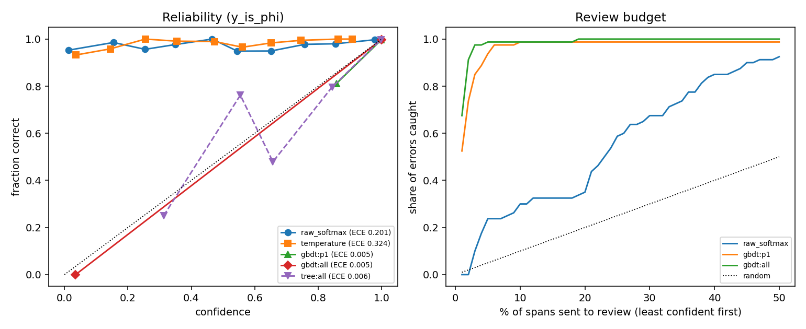

# Confidence models: `cal_v4.rules+model.csv`, target `y_is_phi`

5813 predicted spans, 80 errors (1.38%). 5-fold GroupKFold by note. MC dropout features: no.

| Model | ECE ↓ | Brier ↓ | NLL ↓ | AUROC(error) ↑ | errors caught @5% | @10% | @20% | precision before → after (≤0.1% recall loss) |
|---|---|---|---|---|---|---|---|---|
| raw_softmax | 0.2006 [0.194–0.208] | 0.1318 | 0.789 | 0.765 | 24% | 30% | 35% | 98.62% → 98.62% (−0 errors, −5 PHI) |
| raw_score | 0.0111 | 0.0136 | 0.088 | 0.822 | 64% | 70% | 72% | 98.62% → 98.67% (−3 errors, −5 PHI) |
| temperature | 0.3242 [0.319–0.330] | 0.1563 | 0.537 | 0.764 | 24% | 29% | 35% | 98.62% → 98.62% (−0 errors, −5 PHI) |
| platt | 0.0018 | 0.0135 | 0.069 | 0.750 | 24% | 29% | 41% | 98.62% → 98.62% (−0 errors, −5 PHI) |
| calibrated_mean | 0.0066 | 0.0131 | 0.065 | 0.789 | 29% | 40% | 56% | 98.62% → 98.66% (−2 errors, −5 PHI) |
| gbdt:p1 | 0.0049 [0.004–0.008] | 0.0072 | 0.027 | 0.985 | 94% | 99% | 99% | 98.62% → 99.15% (−31 errors, −5 PHI) |
| gbdt:p1+p2 | 0.0060 | 0.0060 | 0.025 | 0.989 | 95% | 99% | 99% | 98.62% → 99.31% (−40 errors, −5 PHI) |
| gbdt:p1+p2+our | 0.0045 | 0.0046 | 0.017 | 0.996 | 99% | 99% | 100% | 98.62% → 99.57% (−55 errors, −5 PHI) |
| gbdt:our | 0.0048 | 0.0062 | 0.023 | 0.993 | 96% | 99% | 100% | 98.62% → 99.27% (−38 errors, −5 PHI) |
| gbdt:all | 0.0045 [0.003–0.007] | 0.0046 | 0.017 | 0.996 | 99% | 99% | 100% | 98.62% → 99.57% (−55 errors, −5 PHI) |
| tree:p1 | 0.0073 | 0.0123 | 0.056 | 0.909 | 62% | 76% | 88% | 98.62% → 98.64% (−1 errors, −5 PHI) |
| tree:all | 0.0062 [0.005–0.009] | 0.0094 | 0.039 | 0.942 | 90% | 92% | 92% | 98.62% → 98.66% (−2 errors, −5 PHI) |

## ECE by group (gbdt:all vs raw softmax)

| Group | n | errors | ECE gbdt:all | ECE raw |
|---|---|---|---|---|
| category=Address_Location | 504 | 1 | 0.0019 | 0.1915 |
| category=Age_Birthdate | 478 | 10 | 0.0082 | 0.5253 |
| category=Date | 526 | 2 | 0.0010 | 0.0039 |
| category=Name | 2175 | 30 | 0.0038 | 0.1453 |
| category=Organization | 537 | 23 | 0.0231 | 0.3655 |
| category=Other | 86 | 14 | 0.0614 | 0.0953 |
| our_rule_family=format | 1204 | 7 | 0.0033 | 0.1563 |
| our_rule_family=header | 3402 | 12 | 0.0015 | 0.2596 |
| our_rule_family=narrative | 447 | 6 | 0.0005 | 0.1457 |
| our_rule_family=other | 760 | 55 | 0.0240 | 0.0397 |
| lang=en-GB | 2891 | 42 | 0.0050 | 0.2077 |
| lang=en-US | 2922 | 38 | 0.0046 | 0.1935 |
| doc_type=clinic_note | 987 | 9 | 0.0048 | 0.2687 |
| doc_type=discharge_summary | 1007 | 13 | 0.0057 | 0.1696 |
| doc_type=emergency_note | 933 | 11 | 0.0040 | 0.1987 |
| doc_type=laboratory_report | 956 | 19 | 0.0062 | 0.1474 |
| doc_type=nursing_note | 917 | 10 | 0.0048 | 0.1959 |
| doc_type=referral_letter | 1013 | 18 | 0.0082 | 0.2211 |

## Most important features (permutation, gbdt:all)

- `p1_p_o_mean`: 0.0355
- `our_score`: 0.0222
- `p1_p_cat_geo`: 0.0042
- `our_rule`: 0.0020
- `p1_len_words`: 0.0017
- `p2_prev_p_same`: 0.0010
- `p2_pdm_o_b9`: 0.0009
- `p2_frac_words_entity`: 0.0009
- `p1_len_chars`: 0.0008
- `p2_entropy_max`: 0.0007
- `our_rel_pos`: 0.0006
- `p2_note_entity_frac`: 0.0006
- `our_src_both`: 0.0005
- `p2_cv_pmax`: 0.0005
- `our_frac_alpha`: 0.0004
- `p2_top_ratio_mean`: 0.0003
- `p2_pdm_other_b9`: 0.0002
- `our_note_n_same_cat`: 0.0002
- `p1_p_cat_min`: 0.0002
- `p1_frac_words_argmax_cat`: 0.0001

Decision tree (paper 2 style explanations): `tree.txt`.
