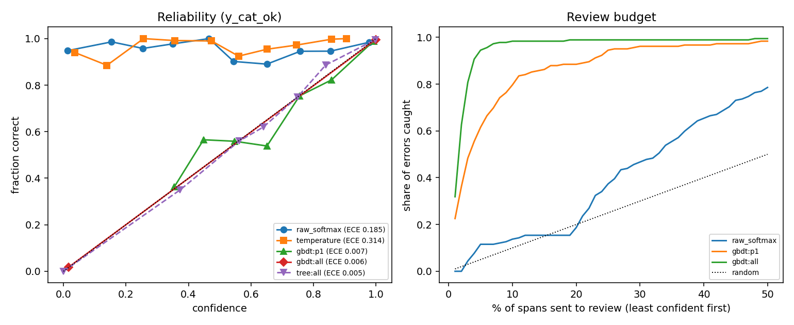

# Confidence models: `cal_v5.rules+model.csv`, target `y_cat_ok`

5800 predicted spans, 182 errors (3.14%). 5-fold GroupKFold by note. MC dropout features: yes.

| Model | ECE ↓ | Brier ↓ | NLL ↓ | AUROC(error) ↑ | errors caught @5% | @10% | @20% | precision before → after (≤0.1% recall loss) |
|---|---|---|---|---|---|---|---|---|
| raw_softmax | 0.1854 | 0.1442 | 0.827 | 0.669 | 12% | 14% | 19% | 96.86% → 96.86% (−0 errors, −5 PHI) |
| raw_score | 0.0197 | 0.0242 | 0.127 | 0.902 | 69% | 85% | 86% | 96.86% → 96.91% (−3 errors, −5 PHI) |
| temperature | 0.3142 | 0.1638 | 0.549 | 0.668 | 12% | 14% | 18% | 96.86% → 96.86% (−0 errors, −5 PHI) |
| platt | 0.0041 | 0.0303 | 0.137 | 0.653 | 10% | 13% | 20% | 96.86% → 96.86% (−0 errors, −5 PHI) |
| calibrated_mean | 0.0073 | 0.0296 | 0.126 | 0.760 | 16% | 30% | 50% | 96.86% → 96.91% (−3 errors, −5 PHI) |
| gbdt:p1 | 0.0072 | 0.0215 | 0.081 | 0.937 | 62% | 80% | 88% | 96.86% → 97.23% (−22 errors, −5 PHI) |
| gbdt:p1+mc | 0.0075 | 0.0200 | 0.076 | 0.947 | 65% | 81% | 91% | 96.86% → 97.31% (−27 errors, −5 PHI) |
| gbdt:p1+p2 | 0.0090 | 0.0151 | 0.064 | 0.955 | 76% | 85% | 91% | 96.86% → 98.01% (−68 errors, −5 PHI) |
| gbdt:p1+p2+our | 0.0062 | 0.0077 | 0.031 | 0.989 | 94% | 98% | 99% | 96.86% → 99.10% (−131 errors, −5 PHI) |
| gbdt:our | 0.0054 | 0.0093 | 0.035 | 0.988 | 90% | 97% | 98% | 96.86% → 98.91% (−120 errors, −5 PHI) |
| gbdt:all | 0.0064 | 0.0079 | 0.031 | 0.989 | 95% | 98% | 99% | 96.86% → 99.03% (−127 errors, −5 PHI) |
| tree:p1 | 0.0081 | 0.0280 | 0.113 | 0.850 | 29% | 42% | 70% | 96.86% → 96.93% (−4 errors, −5 PHI) |
| tree:all | 0.0053 | 0.0115 | 0.047 | 0.950 | 86% | 92% | 92% | 96.86% → 98.39% (−90 errors, −5 PHI) |

## ECE by group (gbdt:all vs raw softmax)

| Group | n | errors | ECE gbdt:all | ECE raw |
|---|---|---|---|---|
| category=Address_Location | 492 | 18 | 0.0317 | 0.1918 |
| category=Age_Birthdate | 478 | 10 | 0.0045 | 0.5253 |
| category=Contactdetails | 314 | 1 | 0.0031 | 0.0129 |
| category=Date | 526 | 3 | 0.0040 | 0.0029 |
| category=Name | 2174 | 38 | 0.0061 | 0.1412 |
| category=Organization | 543 | 26 | 0.0217 | 0.3734 |
| our_rule_family=format | 1178 | 11 | 0.0070 | 0.1492 |
| our_rule_family=header | 3419 | 12 | 0.0013 | 0.2594 |
| our_rule_family=narrative | 447 | 7 | 0.0024 | 0.1435 |
| our_rule_family=other | 756 | 152 | 0.0362 | 0.1265 |
| lang=en-GB | 2889 | 92 | 0.0072 | 0.1931 |
| lang=en-US | 2911 | 90 | 0.0074 | 0.1778 |
| doc_type=clinic_note | 985 | 24 | 0.0071 | 0.2545 |
| doc_type=discharge_summary | 1000 | 27 | 0.0150 | 0.1593 |
| doc_type=emergency_note | 931 | 26 | 0.0079 | 0.1878 |
| doc_type=laboratory_report | 957 | 22 | 0.0045 | 0.1442 |
| doc_type=nursing_note | 915 | 35 | 0.0062 | 0.1702 |
| doc_type=referral_letter | 1012 | 48 | 0.0121 | 0.2025 |

## Most important features (permutation, gbdt:all)

- `our_score`: 0.0487
- `our_category`: 0.0410
- `p1_mc_o_mean`: 0.0123
- `p1_p_cat_geo`: 0.0077
- `p1_len_words`: 0.0015
- `p2_prev_p_same`: 0.0011
- `p1_p_o_mean`: 0.0011
- `p1_len_chars`: 0.0009
- `our_src_both`: 0.0008
- `our_frac_alpha`: 0.0008
- `p1_mc_agree`: 0.0008
- `our_note_n_same_cat`: 0.0008
- `p2_next_p_same`: 0.0007
- `p1_mc_p_cat_min`: 0.0006
- `p2_nb_entropy_mean`: 0.0006
- `our_rule`: 0.0006
- `p2_top_gap_mean`: 0.0006
- `p2_pdm_other_b0`: 0.0005
- `p2_note_entity_frac`: 0.0005
- `p2_entropy_max`: 0.0005

Decision tree (paper 2 style explanations): `tree.txt`.
