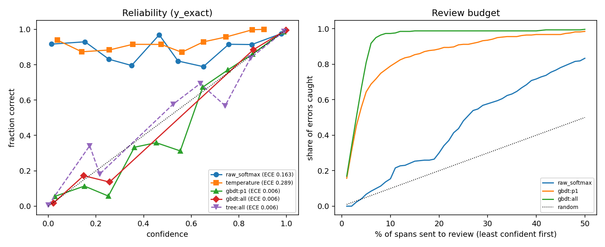

# Confidence models: `cal_v5.rules+model.csv`, target `y_exact`

5800 predicted spans, 343 errors (5.91%). 5-fold GroupKFold by note. MC dropout features: yes.

| Model | ECE ↓ | Brier ↓ | NLL ↓ | AUROC(error) ↑ | errors caught @5% | @10% | @20% | precision before → after (≤0.1% recall loss) |
|---|---|---|---|---|---|---|---|---|
| raw_softmax | 0.1628 | 0.1485 | 0.840 | 0.713 | 7% | 15% | 30% | 94.09% → 94.08% (−0 errors, −5 PHI) |
| raw_score | 0.0457 | 0.0469 | 0.372 | 0.802 | 52% | 64% | 68% | 94.09% → 94.13% (−3 errors, −5 PHI) |
| temperature | 0.2886 | 0.1661 | 0.553 | 0.712 | 6% | 16% | 30% | 94.09% → 94.08% (−0 errors, −5 PHI) |
| platt | 0.0321 | 0.0555 | 0.219 | 0.701 | 6% | 16% | 34% | 94.09% → 94.08% (−0 errors, −5 PHI) |
| calibrated_mean | 0.0097 | 0.0516 | 0.195 | 0.764 | 20% | 34% | 50% | 94.09% → 94.21% (−8 errors, −5 PHI) |
| gbdt:p1 | 0.0064 | 0.0268 | 0.103 | 0.947 | 64% | 79% | 89% | 94.09% → 95.38% (−79 errors, −5 PHI) |
| gbdt:p1+mc | 0.0087 | 0.0269 | 0.105 | 0.946 | 62% | 79% | 89% | 94.09% → 95.41% (−81 errors, −5 PHI) |
| gbdt:p1+p2 | 0.0082 | 0.0169 | 0.067 | 0.975 | 75% | 91% | 95% | 94.09% → 97.25% (−189 errors, −5 PHI) |
| gbdt:p1+p2+our | 0.0051 | 0.0090 | 0.035 | 0.991 | 81% | 98% | 99% | 94.09% → 98.32% (−250 errors, −5 PHI) |
| gbdt:our | 0.0063 | 0.0149 | 0.057 | 0.981 | 76% | 92% | 97% | 94.09% → 97.78% (−219 errors, −5 PHI) |
| gbdt:all | 0.0064 | 0.0091 | 0.036 | 0.991 | 81% | 97% | 99% | 94.09% → 98.27% (−247 errors, −5 PHI) |
| tree:p1 | 0.0072 | 0.0434 | 0.170 | 0.801 | 37% | 46% | 53% | 94.09% → 95.02% (−57 errors, −5 PHI) |
| tree:all | 0.0057 | 0.0201 | 0.082 | 0.946 | 71% | 85% | 92% | 94.09% → 96.79% (−162 errors, −5 PHI) |

## ECE by group (gbdt:all vs raw softmax)

| Group | n | errors | ECE gbdt:all | ECE raw |
|---|---|---|---|---|
| category=Address_Location | 492 | 38 | 0.0317 | 0.1871 |
| category=Age_Birthdate | 478 | 15 | 0.0090 | 0.5214 |
| category=Contactdetails | 314 | 1 | 0.0030 | 0.0129 |
| category=Date | 526 | 3 | 0.0027 | 0.0029 |
| category=ID | 1067 | 1 | 0.0014 | 0.1686 |
| category=Name | 2174 | 110 | 0.0060 | 0.1111 |
| category=Organization | 543 | 89 | 0.0323 | 0.2767 |
| our_rule_family=format | 1178 | 60 | 0.0120 | 0.1085 |
| our_rule_family=header | 3419 | 50 | 0.0033 | 0.2482 |
| our_rule_family=narrative | 447 | 10 | 0.0072 | 0.1368 |
| our_rule_family=other | 756 | 223 | 0.0234 | 0.2178 |
| lang=en-GB | 2889 | 168 | 0.0076 | 0.1716 |
| lang=en-US | 2911 | 175 | 0.0069 | 0.1541 |
| doc_type=clinic_note | 985 | 49 | 0.0062 | 0.2314 |
| doc_type=discharge_summary | 1000 | 56 | 0.0142 | 0.1403 |
| doc_type=emergency_note | 931 | 61 | 0.0133 | 0.1567 |
| doc_type=laboratory_report | 957 | 36 | 0.0051 | 0.1296 |
| doc_type=nursing_note | 915 | 64 | 0.0088 | 0.1441 |
| doc_type=referral_letter | 1012 | 77 | 0.0101 | 0.1822 |

## Most important features (permutation, gbdt:all)

- `our_score`: 0.0539
- `p2_next_p_same`: 0.0136
- `p1_mc_o_mean`: 0.0095
- `p1_p_o_max`: 0.0092
- `our_category`: 0.0085
- `our_rule`: 0.0062
- `our_frac_alpha`: 0.0050
- `p1_p_cat_min`: 0.0044
- `p1_p_cat_geo`: 0.0034
- `p1_len_chars`: 0.0029
- `p1_len_words`: 0.0026
- `p2_nb_p_same_mean`: 0.0024
- `p1_mc_p_cat_min`: 0.0018
- `our_case`: 0.0017
- `our_rel_pos`: 0.0013
- `p2_prev_p_same`: 0.0012
- `p1_p_cat_mean`: 0.0012
- `our_note_n_spans`: 0.0010
- `p2_nb_entropy_mean`: 0.0009
- `p1_mc_p_cat_mean`: 0.0008

Decision tree (paper 2 style explanations): `tree.txt`.
