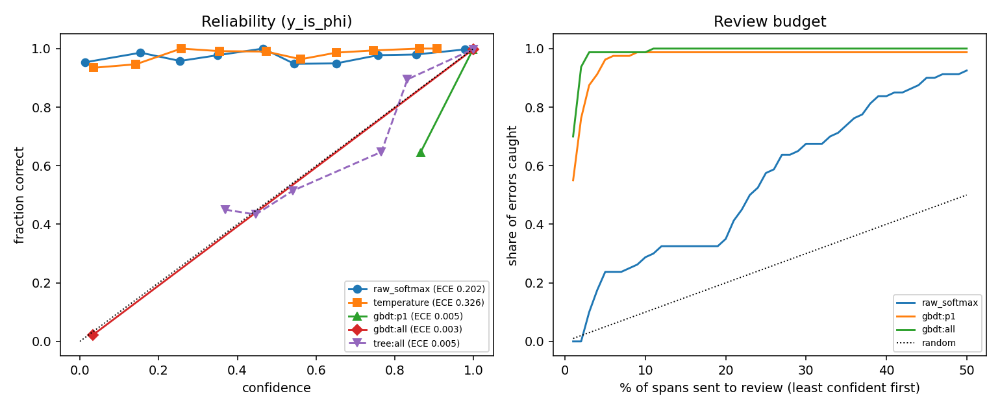

# Confidence models: `cal_v5.rules+model.csv`, target `y_is_phi`

5800 predicted spans, 80 errors (1.38%). 5-fold GroupKFold by note. MC dropout features: yes.

| Model | ECE ↓ | Brier ↓ | NLL ↓ | AUROC(error) ↑ | errors caught @5% | @10% | @20% | precision before → after (≤0.1% recall loss) |
|---|---|---|---|---|---|---|---|---|
| raw_softmax | 0.2022 [0.195–0.210] | 0.1333 | 0.793 | 0.764 | 24% | 29% | 35% | 98.62% → 98.62% (−0 errors, −5 PHI) |
| raw_score | 0.0104 | 0.0133 | 0.087 | 0.824 | 64% | 70% | 72% | 98.62% → 98.67% (−3 errors, −5 PHI) |
| temperature | 0.3258 [0.320–0.331] | 0.1573 | 0.539 | 0.762 | 24% | 29% | 35% | 98.62% → 98.62% (−0 errors, −5 PHI) |
| platt | 0.0019 | 0.0135 | 0.069 | 0.749 | 24% | 28% | 45% | 98.62% → 98.62% (−0 errors, −5 PHI) |
| calibrated_mean | 0.0048 | 0.0131 | 0.064 | 0.799 | 31% | 39% | 59% | 98.62% → 98.67% (−3 errors, −5 PHI) |
| gbdt:p1 | 0.0051 [0.004–0.008] | 0.0072 | 0.026 | 0.985 | 96% | 99% | 99% | 98.62% → 99.03% (−24 errors, −5 PHI) |
| gbdt:p1+mc | 0.0041 | 0.0058 | 0.022 | 0.989 | 95% | 98% | 99% | 98.62% → 99.30% (−40 errors, −5 PHI) |
| gbdt:p1+p2 | 0.0052 | 0.0060 | 0.025 | 0.988 | 94% | 99% | 99% | 98.62% → 99.25% (−37 errors, −5 PHI) |
| gbdt:p1+p2+our | 0.0043 | 0.0045 | 0.018 | 0.996 | 99% | 99% | 100% | 98.62% → 99.56% (−55 errors, −5 PHI) |
| gbdt:our | 0.0032 | 0.0057 | 0.020 | 0.995 | 99% | 100% | 100% | 98.62% → 99.34% (−42 errors, −5 PHI) |
| gbdt:all | 0.0033 [0.002–0.005] | 0.0035 | 0.013 | 0.998 | 99% | 99% | 100% | 98.62% → 99.67% (−61 errors, −5 PHI) |
| tree:p1 | 0.0042 | 0.0120 | 0.053 | 0.919 | 66% | 80% | 90% | 98.62% → 98.65% (−2 errors, −5 PHI) |
| tree:all | 0.0049 [0.004–0.008] | 0.0090 | 0.040 | 0.947 | 90% | 91% | 91% | 98.62% → 98.65% (−2 errors, −5 PHI) |

## ECE by group (gbdt:all vs raw softmax)

| Group | n | errors | ECE gbdt:all | ECE raw |
|---|---|---|---|---|
| category=Address_Location | 492 | 1 | 0.0028 | 0.1956 |
| category=Age_Birthdate | 478 | 10 | 0.0061 | 0.5253 |
| category=Date | 526 | 2 | 0.0022 | 0.0039 |
| category=Name | 2174 | 30 | 0.0036 | 0.1449 |
| category=Organization | 543 | 23 | 0.0144 | 0.3757 |
| category=Other | 86 | 14 | 0.0520 | 0.0953 |
| our_rule_family=format | 1178 | 7 | 0.0033 | 0.1526 |
| our_rule_family=header | 3419 | 12 | 0.0014 | 0.2594 |
| our_rule_family=narrative | 447 | 6 | 0.0010 | 0.1457 |
| our_rule_family=other | 756 | 55 | 0.0159 | 0.0558 |
| lang=en-GB | 2889 | 42 | 0.0042 | 0.2092 |
| lang=en-US | 2911 | 38 | 0.0034 | 0.1952 |
| doc_type=clinic_note | 985 | 9 | 0.0032 | 0.2697 |
| doc_type=discharge_summary | 1000 | 13 | 0.0050 | 0.1718 |
| doc_type=emergency_note | 931 | 11 | 0.0040 | 0.2040 |
| doc_type=laboratory_report | 957 | 19 | 0.0047 | 0.1474 |
| doc_type=nursing_note | 915 | 10 | 0.0060 | 0.1976 |
| doc_type=referral_letter | 1012 | 18 | 0.0061 | 0.2208 |

## Most important features (permutation, gbdt:all)

- `p1_mc_o_mean`: 0.0483
- `our_score`: 0.0215
- `p1_p_cat_geo`: 0.0018
- `our_rule`: 0.0013
- `p2_prev_p_same`: 0.0010
- `our_frac_alpha`: 0.0005
- `p1_len_words`: 0.0005
- `our_rel_pos`: 0.0005
- `p2_entropy_max`: 0.0005
- `p1_p_o_mean`: 0.0005
- `p2_note_entity_frac`: 0.0003
- `p1_mc_agree`: 0.0003
- `p2_pdm_o_b9`: 0.0003
- `our_src_both`: 0.0003
- `p1_mc_std_cat_max`: 0.0002
- `p1_len_chars`: 0.0002
- `p1_mc_std_cat_mean`: 0.0002
- `our_note_n_same_cat`: 0.0002
- `p1_mc_p_cat_min`: 0.0002
- `p2_cv_pmax`: 0.0001

Decision tree (paper 2 style explanations): `tree.txt`.
